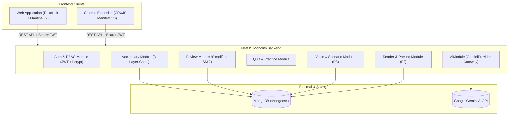

# LinguaFlow 🌐✨

> **AI-Assisted Contextual English Acquisition System**  
> Never learn isolated words. Always capture, review, and master vocabulary in its original authentic context.

[](https://www.typescriptlang.org/)
[](https://nestjs.com/)
[](https://react.dev/)
[](https://mantine.dev/)
[](https://developer.chrome.com/docs/extensions/mv3/intro/)
[](https://www.mongodb.com/)
[](https://vitest.dev/)
[](LICENSE)

---

## 📖 Table of Contents

- [Overview & Philosophy](#-overview--philosophy)
- [System Architecture](#-system-architecture)
- [Core Features](#-core-features)
- [Multi-Agent Engineering Team](#-multi-agent-engineering-team)
- [Project Structure](#-project-structure)
- [Tech Stack](#-tech-stack)
- [Getting Started](#-getting-started)
- [Testing & Quality Verification](#-testing--quality-verification)
- [Architectural Guardrails & Rules](#-architectural-guardrails--rules)
- [Roadmap](#-roadmap)

---

## 💡 Overview & Philosophy

**LinguaFlow** bridges the gap between passive reading/watching and active language retention. Traditional flashcard apps isolate words from where you found them, stripping away nuance and collocations. LinguaFlow creates a **closed learning loop**:

```text
Encounter Word in Reading/Video
       │
       ▼
1-Click In-Context AI Lookup (Chrome Extension / Web Reader)
       │
       ▼
Save to 3-Layer Vocabulary Bank (Lemma → Meaning → Occurrence)
       │
       ▼
Scheduled Spaced Repetition (SM-2 Flashcards with Original Context)
       │
       ▼
Active Practice (AI Quizzes & Daily Life Scenario Conversations)
```

### Core Differentiators
1. **Context-First Guarantee:** A word is never saved in isolation. It is perpetually bound to its parent sentence, video timestamp, and source URL.
2. **Strict Privacy Boundary:** The Chrome Extension operates **strictly** on explicit user selection or word clicks. It **never** scans, transmits, or logs full-page DOMs.
3. **Provider-Agnostic AI:** All generative AI interactions are abstracted behind `AiModule.AIProvider`. Swapping models requires zero refactoring across business domains.

---

## 🏛 System Architecture

LinguaFlow is structured as a **Modular Monolith** serving two client applications through a unified REST API:



---

## ⚡ Core Features

### 1. In-Context Capture (Chrome Extension & Web Reader)
- **Zero-Friction Lookup:** Highlight unknown text on any webpage or click subtitle words on YouTube to instantly receive plain-English meaning and generated usage examples.
- **1-Click Save:** Instantly persist the word with its parent sentence, webpage source title, and URL.
- **Article & Story Reader (`/reader`):** Import or paste articles with interactive click-to-lookup and batch vocabulary extraction.

### 2. Spaced Repetition Flashcards (`/review`)
- **SuperMemo-2 (SM-2) Scheduling:** Pure, deterministic scheduling based on recall quality (`easeFactor`, `intervalDays`, `repetitions`, `dueDate`).
- **Context Reveal:** Practice sentence completion with the target vocabulary highlighted in context.
- **Multi-Modal Video Replay:** When words are captured from YouTube, the flashcard embeds a pre-rolled 5-second video context clip.

### 3. Multi-Modal Study Room (`/video`)
- **Dual Subtitles:** Synchronized native English and translated cues.
- **Dictation Mode:** Type along with masked subtitles and real-time character-level feedback.
- **Shadowing Mode:** Record speech against native audio cues, receiving instant pronunciation feedback.

### 4. Daily Life Scenario Conversations (`/conversation`)
- **Scenario Roleplay:** Practice speaking across real-world situations (Coffee Shop, Hotel Check-in, Casual Interview).
- **Automated SRS Injection:** The backend automatically weaves top due vocabulary items into the conversation prompts.
- **Live Tracker & Phrasing Tips:** Real-time target vocabulary detection with constructive native phrasing alternatives.

---

## 🤖 Multi-Agent Engineering Team

LinguaFlow employs a multi-agent engineering architecture managed through Antigravity plugins ([`.agents/plugins/linguaflow-team/`](.agents/plugins/linguaflow-team/)):

| Agent | Role | Permissions | Scope |
|---|---|---|---|
| `linguaflow-architect` | System Architect & Analyst | Read-only | Evaluates PRD, specs, and designs cross-app execution plans |
| `linguaflow-backend` | Senior Backend Engineer | Read/Write | Owns `backend/`, API contracts, and Mongoose schemas |
| `linguaflow-frontend` | Senior Client Engineer | Read/Write | Owns `frontend/`, `extension/` (MV3), and Mantine UI |
| `linguaflow-qa` | QA & Test Engineer | Read/Write | Vitest unit/E2E suites with mandatory AI/Chrome mocking |
| `linguaflow-auditor` | Security & Code Auditor | Read-only | Independent diff audit against `PROJECT-RULES.md` |

### Guardrails
- **Circuit Breaker:** Max 3 retry cycles between Author and Auditor before emergency stop to avoid token loops.
- **Git Safety Gate:** Sub-agents are strictly forbidden from executing `git commit` or `git push` without human approval.

---

## 📁 Project Structure

```text
LinguaFlow/
├── backend/                   # NestJS Monolith API
│   ├── src/
│   │   ├── core/              # Global interceptors, filters, decorators
│   │   └── modules/           # auth, vocabulary, review, reader, voice, ai, etc.
│   └── test/                  # Supertest E2E specifications
├── frontend/                  # React + Vite + Mantine v7 Web SPA
│   ├── src/
│   │   ├── components/        # Reusable UI components & layouts
│   │   ├── lib/               # Typed API clients matching API-CONTRACTS.md
│   │   └── pages/             # Dashboard, Vocabulary, Flashcard, Reader, Conversation
├── extension/                 # Chrome Extension Manifest V3 (CRXJS + Vite)
│   └── src/                   # Content scripts, background service worker, popup
├── docs/                      # Authoritative Technical Specifications
│   ├── PRD.md                 # Product Requirements & Non-Goals
│   ├── ARCHITECTURE.md        # Monolith architecture & data flows
│   ├── DATA-SCHEMA.md         # 3-Layer Mongoose schema definitions
│   ├── API-CONTRACTS.md       # Canonical REST request/response contracts
│   └── PROJECT-RULES.md       # Security, Manifest V3, and coding standards
└── .agents/                   # Agent configurations, skills, and plugins
    └── plugins/linguaflow-team/
```

---

## 🛠 Tech Stack

| Domain | Technologies |
|---|---|
| **Backend** | NestJS 12, Node.js (ESM), TypeScript, Mongoose 9, Passport JWT, bcrypt |
| **Frontend** | React 19, TypeScript, Vite, Mantine UI v7, Tabler Icons, Axios |
| **Chrome Extension** | TypeScript, Vite, CRXJS, Chrome Manifest V3 APIs |
| **Database** | MongoDB (with TTL indexes for AI caching) |
| **AI Integration** | Google Gemini API via official `@google/genai` SDK |
| **Testing & Linting** | Vitest 4/5, React Testing Library, Supertest, Oxlint |

---

## 🚀 Getting Started

### Prerequisites
- **Node.js:** `>= 20.x`
- **MongoDB:** Running locally on `mongodb://localhost:27017/linguaflow` or remote URI
- **Google Gemini API Key**

### 1. Backend Setup
```bash
cd backend
cp .env.example .env
# Edit .env with your MONGODB_URI, JWT_SECRET, and GEMINI_API_KEY

npm install
npm run dev        # Starts NestJS server at http://localhost:3000
```

### 2. Frontend Setup
```bash
cd frontend
npm install
npm run dev        # Starts Vite dev server at http://localhost:5173
```

### 3. Chrome Extension Setup
```bash
cd extension
npm install
npm run dev        # Watches and builds extension into extension/dist/
```
1. Open Google Chrome and navigate to `chrome://extensions/`.
2. Enable **Developer mode** (top-right toggle).
3. Click **Load unpacked** and select the `extension/dist/` directory.

---

## 🧪 Testing & Quality Verification

In accordance with our engineering verification standards, live Gemini APIs are **never** invoked during automated tests.

```bash
# Run unit tests across all applications
npm --prefix backend test
npm --prefix frontend test -- --run
npm --prefix extension test

# Run backend E2E contract tests (Supertest + Vitest)
npm --prefix backend run test:e2e

# Run static analysis (Oxlint)
npm --prefix backend run lint
npm --prefix frontend run lint
```

---

## 🛡 Architectural Guardrails & Rules

All developers and AI agents must strictly abide by [docs/PROJECT-RULES.md](docs/PROJECT-RULES.md):

1. **The 3-Layer Vocabulary Chain:** Vocabulary is always stored as:
   $$\text{VocabularyItem (Lemma)} \longrightarrow \text{Meaning} \longrightarrow \text{Occurrence (Sentence + Source)}$$
   *Never flatten this structure into a single collection.*
2. **AI Layer Isolation:** Only `backend/src/modules/ai/` may import the Gemini SDK. All domain modules communicate strictly via `AIProvider`.
3. **Response Envelopes:** All endpoints strictly return `{ success: true, data }` or `{ success: false, error: { code, message } }`.
4. **Extension Privacy:** Never transmit `document.body.innerText` or full DOM. Only transmit user-selected tokens and minimal parent sentence context.

---

## 🗺 Roadmap

- [x] **Phase 1: MVP Core Loop** — In-context capture, 3-layer storage, SM-2 Flashcards, AI Quizzes.
- [x] **Phase 2: Multi-Modal Immersion** — YouTube dual subtitle overlay, Dictation, Speech Shadowing, Video Study Room.
- [x] **Phase 3.1: Authentic Reader** — Article & Story Reader with interactive click-to-lookup and batch save.
- [x] **Phase 3.2: Scenario Conversation** — Real-time situational speaking practice with automated due vocabulary injection.
- [ ] **Phase 3.3: Progressive Web App (PWA)** — Offline flashcard caching with IndexedDB FIFO sync queue and installable mobile manifest.
- [ ] **Phase 3+: 3D Spatial Preposition Sandbox** — Interactive vector visualization for prepositions of movement (*walk along, jump over*).

---

## 📄 License

This project is licensed under the MIT License — see the [LICENSE](LICENSE) file for details.
